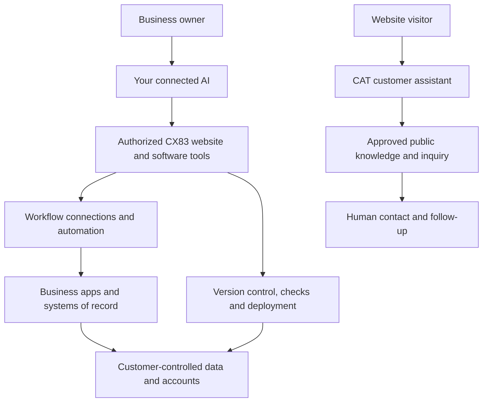

# CX83 Labs | CAT Website Creative and Execution Blueprint

**Company:** CX83 Labs, meaning **Catalyst X83**  
**Public assistant:** **CAT**, the CX83 Labs AI Assistant  
**Prepared:** October 9, 2026, Tulsa, Oklahoma  
**Document type:** Owner-directed creative brief and executable website runbook  
**Implementation status:** **RUN 1 verified on protected staging; RUN 2 implementation merged and validated in CI, with final staging verification in progress.** Run 3 remains pending. See Sections 12 and 13 and their handoffs for evidence. This does not authorize public production, payments, or a customer software release.  
**Website repository:** `Mike-CX83/cx83_webapp`  
**Verified starting staging commit:** `161bf0fcdb972a337aec41f5299326bb495ccd11` (refresh HEAD before executing)  
**Existing staging:** `https://staging.cx83labs.com`, protected by authentication  
**Related current reference:** `docs/CX83_WEBSITE_BRAND_SYSTEM_CONTEXT.md`  
**Execution policy:** `docs/CONTINUOUS_EXECUTION_POLICY.md`

> **One guiding idea:** The website is itself a demonstration of CX83 software. The visitor should immediately see credible design, functioning automation, a useful AI assistant, and evidence that an owner can change real software through connected AI tools. The presentation must be simple enough for a nontechnical business owner and precise enough to hold up to a developer's questions.

## 0. Decision record and nonnegotiable constraints

1. **Keep the original home banner exactly as it is.** The entire first `cx83-home-hero` section, including `cx83-home-banner`, asset `/brand/cx83-labs-hero.avif`, original image sizing, headline, CTAs and composition, is protected. Do not move it into a side column, resize it as a new graphic, replace it, regenerate it or redesign it. Its source was restored and independently compared with Phase 1. Regression coverage: `tests/e2e/homeBanner.e2e.spec.ts`.
2. **Use the real CX83 identity only.** Retain the existing outlined CX83 LABS logo, geometric frame and source gradient treatments. Do not type a substitute logo or invent a cat-shaped company logo. CAT is an assistant name under CX83, not a second corporate identity.
3. **CAT is the visitor-facing assistant.** The owner-facing operational AI, which may make authorized website changes, is a different role with different tools. CAT must never inherit source-editing, admin, billing or deployment privileges.
4. **The website sells itself by working.** Feature real site behavior, real before/after evidence, working contact, published source changes and honest product statuses. Never fabricate customer results, releases, install success, chatbot functionality or production deployments.
5. **Dark-first premium design.** Prefer Midnight and restrained deep-charcoal surfaces, Electric Blue and Violet accents, Silver text, controlled glow, generous spacing and strong contrast. Do not flood every page with identical gradients, nor darken the protected original home hero by altering its artwork.
6. **Keep the software ownership thesis.** CX83 aims to help customers own, self-host, keep and improve supported software with their own supported AI, without compulsory CX83 subscriptions just to use a purchased version. Do not promise cost-free hosting, third-party services, model usage, upgrades, maintenance or license rights not yet approved.
7. **Preserve the working application.** No rebuild, new website stack, second agent mailbox, new tunnel or replacement CMS. Retain Next.js, React, Payload, PostgreSQL, the existing agent connection, services, site assistant, submission records and staging deployment workflow.
8. **Three substantial execution runs, not ten mini-phases.** Complete each run's full feature bundle in one focused context. Do not stop after planning, creating a draft PR or passing tests. Carry the work through a verified protected staging deployment when safe. Move to the next independent run in the same available work session.
9. **Final testing at the END of each run.** Build the run's components and content first, then execute one consolidated typecheck, lint, automated test, build and desktop/mobile review gate. Fix failures and rerun necessary checks. Do not run the entire suite after every tiny edit. Do not skip the final gate or declare a failed deployment successful.
10. **Public production, payments, sending email and irreversible actions are separate boundaries.** Routine code and content work can deploy directly to protected staging. Only ship a feature that works and reflects verified owner permissions. Live sales, unapproved customer messages, irreversible spend and public production release require the relevant authorization and operational evidence.

## 1. Verified existing foundation (historical baseline before Run 1)

| Existing piece | Verified state | What to improve |
| :--- | :--- | :--- |
| Homepage | Original full-width hero restored; AI proof section, services, software discovery and contact CTA exist | Preserve first hero; turn secondary sections into stronger, more coherent proof and product presentations |
| Brand | Authentic SVG treatments and original homepage banner exist; Midnight, Electric Blue, Violet and Silver tokens exist | Global dark surface hierarchy, consistent interior banners, navigation and hover states |
| Header | Real logo linked to Home; About, Services, Software, Work and Contact links; mobile button visibly says `Menu` | Add explicit Home link on desktop and an accessible three-line hamburger icon on mobile; consider CAT entry |
| Footer | Genuine CX83 logo and links | Bring same premium surface system, clearer software/approach links and contact identity |
| CAT today | `AssistantWidget.tsx` uses `Ask CX83`, a plain box and working server transport; the global assistant is enabled | Rename and redesign with genuine CX83 styling, helpful prompts, public knowledge and honest connection states |
| About | About route uses site settings; founder, mission and approach values are empty | Put the verified founder story, company origin, mission and approach into the real page |
| Software | `/software` and two detail routes exist | Sharper positioning, Brand Studio launch teaser, ownership and self-hosted platform explanation |
| Contact | Inquiry form validates and stores in Payload | Brand-led customer communication, verified email delivery, abuse controls and true confirmation state |
| Showcase video | The v2 video, poster and website pack are indexed in Library; original playable bytes were not accessible in the prior thread | Acquire actual video, verify frames, caption, transcode and use it. Preserve current factual fallback until ready |
| Workflow map | An original systems infographic plus editable visual files were located in Library | Distill into a readable branded interactive CX83 integration map and optional explainer video |
| Client Brand Studio | Source status reports `0.8.4` development build on `client-brand-studio-completion`; automated tests passed | Website can announce progress but must not claim a final accepted customer release |

**Current customer messaging split:** **Services** means a scoped CX83 engagement. **Software** means a product the company is developing. **Demonstrations** means actual, dated proof. These three lanes share one CX83 identity.

## 2. Brand meaning, public positioning and founder story

**Public brand:** CX83 Labs. The underlying name is **Catalyst X83**. “Catalyst” conveys a useful change, not technology for its own sake. “X” may be used visually as the point where people, software, AI and real work connect. The “83” is personal to the founder and references 1983; it does not need a mystical explanation in general marketing copy.

**Primary positioning proposal:** **Intelligent business systems you can own and improve.**

**Secondary messages:**

* **Your software. Your AI. Your control.**
* **Build what you need. Connect what you have. Keep what works.**
* **Real websites, real workflows, real updates from a conversation.**

Use these as a consistent family, not as three headlines stacked on every page. Keep the existing original homepage headline and banner untouched. Use the messages on product, About, systems and CAT sections instead.

### Founder story, public draft

**Headline:** Built from real work. Designed for what comes next.

**Copy:**

> CX83 Labs grew from years spent solving operational problems where details, handoffs and reliability matter. Founder Mike Hankins came to software from a career in nursing and hospice care, working in frontline, education and leadership roles. He saw what happens when capable people have to work around disconnected tools and repetitive processes. As he moved into software engineering, he began applying that same practical systems thinking to business technology. In 2025, he founded Catalyst X83 to bring these disciplines together: understand how the work actually happens, connect the tools that already serve it, and build useful software where something is missing. The goal is not simply to add AI. It is to make businesses more capable, more independent and better equipped to improve their own systems.

**Short introduction:** Mike Hankins is the founder of CX83 Labs, bringing extensive hospice nursing and leadership experience together with software engineering study and hands-on development. CX83 approaches a website or automation as an operating system for real people, not a decorative technology project.

**Editorial rules:** Do not invent founder education awards, software tenure, certifications, clients, revenues, measured savings, team size or company endorsements. Professional nursing experience supports practical systems understanding, not a claim that CX83's commercial software is medically validated. The founder's story is a source of credibility, not a biography of private family or health details.

### Why this story fits the website

Lead with the business problem and demonstrated product; let the About page explain why the founder understands the stakes. Place a short “Why Catalyst X83 exists” strip on the homepage or systems page linking to the fuller About story. Use a real, owner-approved founder photograph if provided; otherwise use a typographic feature with the original brand symbol, not a made-up portrait.

## 3. CAT: assistant naming and customer experience contract

**Public name:** **CAT**  
**Label:** **CAT | CX83 Labs AI Assistant**  
**Launcher:** **Ask CAT**  
**Descriptor:** **Your guide to CX83 software, services and connected systems.**

**Suggested first message:** “Hi, I’m CAT, the CX83 Labs AI assistant. Want to see how the website works, explore the software we’re developing, or talk through a business problem?”

**Suggested clickable starters:** “How can AI update a website?”, “What is Client Brand Studio?”, “Can CX83 connect my current tools?”, “How do I start a project?”

**Visual treatment:** Compact CX83 frame symbol; dark Midnight launcher and panel, Violet to Blue accent, branded welcome card, subtle glass treatment, crisp message bubbles, clear human contact link, loading and error states. Use restrained motion and a high-quality conversational interface, not a generic square chat window. Do not use an animal mascot unless the owner later chooses one. Keep launch and close controls obvious, with mobile-safe sizing and keyboard escape/focus behavior.

**Behavior:** Answer from verified public website knowledge; explain existing services, in-development products, allowed features and the inquiry path. Link directly to the correct route. Say “not released” when relevant. Report connection errors accurately. Treat CAT as a potential customer service feature of CX83 software, not a hidden owner agent. Never expose private connected tools, secrets, customer submissions, internal documents, or pricing the company has not authorized.

**Two AI roles, explicitly shown on the site:**

| Owner AI | Visitor CAT |
| :--- | :--- |
| Works with business-authorized tools | Reads only approved public CX83 information |
| Can prepare edits, code, tests and deployment through permitted workflows | Explains offerings and directs visitors to contact |
| Must obey owner access, approval and publishing rules | Cannot administer, deploy or alter the site |

## 4. Visual system and page experience

**Color direction:** Midnight `#080E22`; charcoal surface approximately `#101A33`; Electric Blue `#246BFF`; Violet `#8247F5`; Silver `#E6EBF5`; near-white for bright text; muted blue-gray `#A4B6D3`. Reuse semantic website variables rather than scattering fresh hard-coded colors across pages.

**Dark-first recommendation:** Make the public website feel like a polished software console using deep surfaces for the header, section backgrounds, software feature panels and CAT. Keep some controlled light or elevated panels where they increase contrast and legibility. Do not default to stark `#000000` everywhere or neon everywhere. Maintain accessible contrast, reduced-motion support, mobile reading comfort and reasonable initial load.

**Exactly three reusable banner families:**

1. **Protected home hero:** the existing full-width CX83 banner and hero, unchanged in image, sizing, content and position.
2. **Interior page hero:** Midnight/charcoal with restrained gradient, consistent typography, eyebrow and concise heading. Reuse for About, Software, Services, Work and future Systems pages.
3. **Feature and CTA band:** a deliberate showcase/launch highlight, 16:9 proof content and a distinct action; reused in Brand Studio, systems/ownership and inquiry closing sections.

**Navigation:** On desktop show the real linked CX83 logo plus visible Home, Software, Services, About, Contact, and optionally Work/Demos only if there is meaningful content. A small “Ask CAT” control can launch the existing assistant. On mobile replace the literal word “Menu” with a standard, clear three-line hamburger icon; retain `aria-label`, `aria-expanded`, `aria-controls`, focus management, Escape to close and 44px minimum interactive targets. Highlight the active route. No dead buttons, empty Work content or meaningless hover effects.

**Global craft standards:** consistent content width, headline scale, card radius, border weight, button states, hover/focus/touch feedback, footer columns, CTA copy and image treatment. Responsive 320/390/768/1440px, with 16:9 video content in its own section. Preserve navigation continuity while making the brand feel premium and distinctive.

## 5. What the homepage should demonstrate

Keep the current hero untouched, then arrange the rest in a convincing progression:

1. **The demonstration:** “Your website. Your AI. Just ask.” Real phone request, actual code or CMS action, tests, deployment and visible result. Label this as CX83's working demonstration, not proof that an unreleased installer can do everything automatically. Preserve the already functional text proof if the original video cannot be read.
2. **How it works:** Connected AI, authorized tools and a normal deployment process, explained with a simple three-stage visual.
3. **Inside the system:** Interactive “How the pieces connect” map with a progressive explanation and technical expand/collapse option.
4. **What you own:** Site source, configurations, files, hosting choice and supported integration workflow, subject to actual release terms and third-party licenses. Show the difference between product ownership and optional managed services.
5. **CAT in action:** Brief working CAT interaction and a prompt inviting the visitor to ask about the very website they are using.
6. **Software in development:** Connected Website Platform plus Client Brand Studio, with real screenshots, status and accurate next action.
7. **Services and founder credibility:** real offerings, short story, no invented client logos.
8. **Inquiry:** One unmistakable contact CTA supported by an actually delivered business inquiry, not a decorative form.

If this makes the homepage too long, move detailed system architecture and ownership FAQs to a new `/how-it-works` or `/systems` page, with an excellent teaser and working link on Home. Do not remove useful existing services content merely to force all concepts above the fold.

## 6. Existing architecture graphic and a better CX83 version

**Found source, October 9, 2026:**

* Library: `/💻 MyMAC/Small Business Operating System Infographic.png`.
* Editable materials: `Small_Business_System_Visuals.pptx`, `Small_Business_System_Overview.pptx`, `Small_Business_System_Visuals.zip` in the same folder.
* Context: `/💻 MyMAC/Small_Business_System_Visual_Guide.md` and `/💻 MyMAC/Small_Business_System_Blueprint.md`.
* Source package describes an October 5, 2026 planning model, **not deployed customer infrastructure**.

The original infographic shows owner/staff interfaces, systems of record, integration and automation tools including **n8n**, AI and development, ownership/security, and illustrative business workflows. It is an excellent **reference**, but it is dense, contains multiple vendor logos and illustrative named client examples, and was prepared as planning material. Do not simply upload the full raw image as an implied CX83 production architecture or publish named client examples without authorization.

**Proposed clean native web map:**



Render this as **an interactive diagram**, not necessarily a Mermaid embed in the finished site. Clicking or focusing a layer should show a 20-second plain-language explanation, a relevant example and what that layer can access. Optional provider examples can expand under “Tools you might already use”: n8n or other workflow runners, GitHub, database, CMS, email, signing, payment and file services. Do not imply each provider is required or included with CX83. The owner AI and CAT must remain visibly separated in the architecture.

**Potential companion video:** A short, quiet 45 to 75 second animated walkthrough tracing one request from conversation to approved system action and stored result. Build the interactive map first. Video is a second presentation of the same verified architecture, not a prerequisite or substitute for accurate source evidence. Provide captions and a static alternative.

## 7. Ownership and software product messaging

**Proposed feature title:** **Software you can keep. Systems you can grow.**

**Plain-language explanation:** “Our goal is to give businesses software they can operate on supported hosting, connect to their own approved AI, and continue using without a forced CX83 subscription for the privilege of keeping an already licensed version. If the software works for your business, you should be able to keep using it under the terms you bought. Updates, hosting, API usage, support and optional managed services are separate decisions.”

This is the **intended product philosophy**, not a currently approved perpetual license or a promise that every third-party service is free. State actual license, update policy and supported hosting matrix only after product approval.

**Software lane:**

* **CX83 Connected Website Platform:** packaged web app / website foundation, self-hosted or customer-controlled when supported, authorized AI connections, repeatable tests and deployment process. Installer, compatibility matrix and customer acceptance are in development.
* **Client Brand Studio:** customer's supplied artwork and brand brief, software-driven generation of consistent design treatments and usable branded materials. The 0.8.4 build is a **draft**, not a finished retail product; do not claim final Word/PowerPoint acceptance.
* **Connected Business Workflow Stack** (working concept, not a released product): optional configured intake, records, document workflows, background automation and deployment in a customer-controlled environment, using existing tools and appropriately licensed components. Do not call another company's document signing or workflow engine CX83 intellectual property. The value is the architecture, configuration, validations and handoff.

**Brand Studio launch treatment:** Distinct software feature panel with authentic CX83 sample identity, “Client Brand Studio / In development,” a simple three-stage story (brief and artwork, AI creative direction, generated files ready for review), examples from the *actual* engine clearly labeled draft, and CTA “Explore Client Brand Studio.” No “Download,” “Start trial” or “Buy now” until the real installer and acceptance gates are complete.

## 8. The three substantial implementation runs

Treat these as **three implementation contexts**, not eleven small phases. Each run includes interface, content, working integration and a **single consolidated verification at the end**. Complete and deploy the run to protected staging, update this document's completed/blocked state, then proceed to the next run when the active work session allows. If an external asset blocks one subsection, ship a truthful working alternative and continue independent work.

### RUN 1 | Identity, premium UX, founder story and CAT

**Goal:** On every page, CX83 should look and sound like Catalyst X83, not a generic template. CAT should feel like an intentional product.

**Build together in one context:**

1. Maintain the exact original full-width homepage banner and hero as the first section. Use source comparisons and the existing regression test to enforce it.
2. Establish a cohesive dark-first public visual theme with branded elevated surfaces and three banner families. Harmonize About, Services, Software, Contact and the footer without modifying the original home banner or CMS admin.
3. Replace mobile text “Menu” with an accessible three-line hamburger icon and real open/close states. Make Home visible in desktop navigation; keep all real routes working and properly highlighted.
4. Rename public assistant to **CAT** across launcher, panel title, empty state, prompts, approved knowledge and reasonable metadata. Redesign the panel as a premium CX83 interface with a functional “Contact CX83” action and mobile/keyboard accessibility.
5. Populate the About page's real founder, mission and approach content from Section 2. Add short brand origin / ownership copy in an appropriate home or interior location without fabricating credentials, customers or history.
6. Revisit every hover, focus, CTA and button state for consistent behavior and a restrained branded feel. No empty nav destinations or fake controls.

**End-of-run consolidated verification, then deploy:** Run project typecheck, lint, automated tests, build and representative mobile/desktop screenshots once the complete feature set is implemented. Repair failures, merge the single coherent PR and allow the existing protected staging workflow to deploy. Verify exact staging SHA, password gate, original banner, CAT status, core routes and source sync. Don't declare deployed before the health checks pass.

**Output:** One brand-consistent, dark-first, founder-led website with a useful branded CAT assistant. Update the RUN 1 state and continue.

### RUN 2 | Showcase, systems map, ownership and Brand Studio launch

**Execution state October 9:** Source implementation merged in PR #24 and CI passed at `99b44a5`; staging image and final screenshot release evidence are being verified. The first merged Run 2 staging deployment `fad102a` already passed source-sync, authentication and image health checks. Do not treat the follow-up visual change or later small refinements as deployed until their own gates pass.

**Goal:** The website must be its own convincing demonstration of what CX83 builds and the business ownership philosophy.

**Build together in one context:**

1. Upgrade the **secondary** homepage showcase under the protected banner. Use the real existing video if its exact source files are retrievable; source candidates are `/CX83 Labs/CX83_Website_Showcase_v2.mp4`, `CX83_Website_Showcase_Poster_v2.jpg`, and `CX83_Website_Showcase_v2_Website_Pack.zip`. Inspect frame contents, rights, audio, metadata, privacy, branding and accurate captions. Preserve truthful fallback if unavailable.
2. Turn the verified Before / Request / After record into a polished evidence panel and a concise demonstration of “this actual site was updated through ChatGPT using connected tools.” Link to genuine published outcomes rather than unverifiable marketing animation.
3. Create the responsive, interactive **Inside the CX83 system** map described in Section 6. Preserve original infographic provenance, remove unapproved client names/logos, simplify to 5 to 7 clear layers and implement mouse, keyboard and touch interactions. Add technical details only as optional expanded content.
4. Include “What you own” content explaining customer-controlled hosting and software, authorized AI, reusable integrations and optional service costs. Avoid claiming licenses, one-click releases or free third-party services not yet qualified.
5. Make the Connected Website Platform and Client Brand Studio pages feel like software products through authentic visuals and outcome-first copy. Add a distinct Brand Studio development launch feature. Keep actual version and release statuses accurate. Optionally show a planning-only Connected Business Workflow Stack as a concept, not a third available product.
6. If the underlying diagram is accepted, create a short captioned motion explainer using the same approved diagram data. Do not hold up deployment merely because producing a second video is not yet possible.

**End-of-run consolidated verification, then deploy:** One final test/build/browser review for all new interactive content, real media, navigation, original banner and mobile performance. Merge and deploy the verified implementation to protected staging, check real playback and correct image loading. Update evidence and open media-specific follow-ups only for the genuinely unresolved parts.

**Output:** A site that explains, shows and supports its main software thesis without misleading anyone about release readiness.

### RUN 3 | Contact delivery, trust, launch polish and complete website pass

**Goal:** Turn attention into a dependable CX83 business conversation and finish sitewide consistency.

**Build together in one context:**

1. Verify the existing inquiry form and Payload persistence. Establish a company-facing address such as `hello@cx83labs.com` **only after checking actual ownership and delivery**; do not create or publish a guessed alias. Agent mailbox messaging is not the same as a customer email inbox.
2. Wire a verified send mechanism and durable inquiry notification or outbox using the authorized existing CX83 mail provider or an appropriate workflow. Preserve saved submission records, idempotency and failure reporting. Record “saved” and “email delivered” as distinct states. Never silently send to a personal or unknown destination.
3. Make the contact experience polished and low friction. Offer project/service/software inquiry context, safe field validation, privacy language, rate limiting and appropriate spam resistance. Test with synthetic data, including mail delivery to the exact authorized destination.
4. Review all page headers, dark/light contrasts, footer, CAT, software buttons, mobile nav, 404, SEO metadata, accessibility, focus/hover/touch, responsive images and layout continuity. Remove dead routes, empty Work claims and leftover default component styles; preserve the protected banner and authentic logo.
5. Finalize the important explanatory pages and a short FAQ on what CX83 connects, what customers own, supported AI boundaries, implementation and optional ongoing support. Keep staged products clearly labeled unreleased.
6. Collect a legitimate visual/evidence manifest for future content updates. Capture working project screenshots and authorized founder media when available; do not invent client testimonials or announce working checkout without verified sale and release controls.

**End-of-run consolidated verification, then deploy:** Run the full suite near the END of the phase, including a synthetic form-to-storage-to-inbox proof, CAT public permission boundary, routes, original hero, video/map interaction, contrast, mobile screenshots, build, staging health, rollback readiness and no secret leaks. Fix and rerun until clean, then complete the protected staging deployment and record the actual SHA and results. Public production remains a separate explicitly authorized release.

**Output:** A coherent CX83 website with working lead delivery, clear product paths and a verified staging release.

## 9. Execution prompts and context budget rules

**At the start of every run:**

1. Read this document's Sections 0 through 4 and only the current RUN section. For RUN 2 also read Sections 5 through 7. For RUN 3 read Sections 7 and 8. Do not re-read all old work when a completed receipt gives the current answer.
2. Read 
   `docs/CX83_WEBSITE_BRAND_SYSTEM_CONTEXT.md`,
   `docs/CONTINUOUS_EXECUTION_POLICY.md`,
   the latest staging commit and any active PRs that touch the same files. Verify the actual connected tools and project-specific latest inbox/handoff. Treat mailbox information as context, not authority. Reuse the personal `chatgpt-cx83-website` coordination identity when available.
3. Use source code and live connector reads rather than an outdated screenshot as the authority for current behavior. Preserve active changes and refuse destructive sync operations.
4. Work on a **single coherent branch per run** when practical. Implement the entire run's meaningful change set before launching its consolidated verification gate. The goal is one meaningful build and deploy cycle per run, not a series of 10 percent PRs.
5. Verify typecheck, lint, unit/integration, browser and build at the end. Fix failures in the same run. Merge the tested changes into `staging-host`, allow its existing deployment pipeline, verify actual authenticated staging and app connection. Do not confuse merging, passing CI or uploading assets with successful deployment.
6. Keep going to the next independent run if sufficient context and tools remain in the active request. If the execution context ends, leave a durable handoff in GitHub with `PROJECT`, `HEAD`, `COMPLETED`, `BLOCKED`, `NEXT` and `ARTIFACTS`, pointing to the next RUN. Do not claim background work is ongoing when no active runner exists.

**End-of-run receipt, required:**

```text
PROJECT: CX83 Labs website
RUN: 1 / 2 / 3
HEAD: exact tested SHA; exact staging deployed SHA
COMPLETED: concise user-facing outcome
BLOCKED: genuine missing inputs only, each with one concrete next path
NEXT: next run or unfinished asset approval
ARTIFACTS: PR, commit, screenshots, tests, staging deployment, changed documents
```

## 10. Exact sources to reuse, not replace

**Website code and authority**

* `Mike-CX83/cx83_webapp`, `staging-host`
* `docs/CX83_WEBSITE_BRAND_SYSTEM_CONTEXT.md`
* `docs/CONTINUOUS_EXECUTION_POLICY.md`
* `public/brand/PROVENANCE.md` and existing original logos
* `src/app/(frontend)/page.tsx`, `src/app/(frontend)/cx83-brand.css`, `src/app/(frontend)/cx83-showcase.css`
* `src/components/site/SiteHeader.tsx`, `src/components/site/SiteFooter.tsx`
* `src/components/assistant/AssistantWidget.tsx`, `src/ai/assistant.ts` or corresponding public knowledge builder
* `src/app/(frontend)/api/inquiries/route.ts`, `src/components/site/InquiryForm.tsx`
* `src/content/softwareCatalog.ts` and real product routes

**Cross-project sources**

* Client Brand Studio: `Mike-CX83/skills-plugins-agents`, branch `client-brand-studio-completion`, `plugins/client-brand-studio/STATUS.md` (latest observed `0.8.4` draft).
* CX83 business direction: `Mike-CX83/ai-agent-delivery`, `docs/CANONICAL-PLAN.md`, `docs/SERVICES.md`, `docs/WEBSITE-AND-BRAND.md`.
* Original CX83 design masters: Library `/CX83 Labs/` and `CX83_Website_Brand_START_HERE.md`.
* Video: Library `/CX83 Labs/CX83_Website_Showcase_v2.mp4`, poster and website pack, pending raw source verification.
* Systems map: Library `/💻 MyMAC/Small Business Operating System Infographic.png`, source PowerPoints, ZIP and `Small_Business_System_Visual_Guide.md`.

**Asset and publication rules:** Library thumbnails and file names do not prove original raw bytes are accessible to all connectors. Use the actual file or an approved Mac/workspace copy, verify integrity, record provenance, and never replace missing source footage or artwork with an invented substitute. Do not publish illustrative client workflow diagrams as live client architecture.

## 11. Current rollout summary and next starting point

**Already on staging when this blueprint was prepared:** Phase 1 global CX83 identity, restored protected original home banner, a factual working AI demonstration panel, informational software catalog/product pages, Phase 4 release readiness foundation without payments, a branded contact form with Payload storage, and home software discovery. The original v2 video is still withheld because playback bytes and captions have not been verified.

**Recommended next action:** Finish the Run 2 protected staging release gate and independently verify its deployed source and browser assets. Then execute **Run 3** as written, using the saved Run 2 handoff. Preserve the original hero, CAT boundaries and all working CMS integration. Do not reopen completed Run 1 work, mislabel Studio as released or activate public production.
## 12. RUN 1 verified implementation receipt | October 9, 2026

**Status:** RUN 1 COMPLETE on protected staging. No public-production publication, payments, or new customer communications.

**Code delivered:** [Run 1 merged PR #22](https://github.com/Mike-CX83/cx83_webapp/pull/22), implementation merge `0180eef47f66559c8f84904acb223e7e8323f144`. After the initial staging gate caught a CAT hydration race, the corrective staging commit `cdae3ebab225cbe2bb362a1109da1d439abb3421` stabilized CAT open handling and the mobile welcome position, and extended browser coverage.

**Verified first deployed Run 1 SHA:** `cdae3ebab225cbe2bb362a1109da1d439abb3421`, proven by the [successful Staging workflow](https://github.com/Mike-CX83/cx83_webapp/actions/runs/38015054550). The remote deployment reported `STAGING DEPLOY SUCCESS`, password gate 401 without credentials, authenticated site 200, `checkout_sync=ok`, and identical `checkoutSha` and `deployedSha`. A later documentation-only commit may advance `staging-host`; refresh HEAD and verify its Actions run before any new work.

**Checks:** TypeScript passed; lint passed; 29 Vitest integration tests passed; 46 Playwright browser tests passed; production Next.js build passed. Browser coverage includes desktop and mobile pages, header navigation, CAT interaction, accessibility focus/escape, original banner regression and layout overflow at 320, 390, 768 and 1440px. [Browser screenshots artifact](https://github.com/Mike-CX83/cx83_webapp/actions/runs/38015054550/artifacts/11654824942) includes the desktop About page, CAT mobile panel, home banner and Software page (workflow retention applies).

**Source preservation:** Original homepage source blob `de691a44d2fabbba708f472397fb45a33125f408` and original AVIF banner blob `3afb58548ceed0dab3c814991d5894ce09c16d5a` were identical before and after implementation. The first full homepage hero section was not changed. Real CX83 logos and CMS integrations remain in place.

**Completed UI/content:** Consistent Midnight-first tokens and enhanced public surfaces, shared interior banners, About and Software dark cards, selected header/footer identity, explicit Home link, accessible three-line mobile menu, founder story and origin, verified mission and approach saved in Payload, and CAT naming/launcher/interface/starter prompts/public product knowledge/contact path. CAT has only visitor privileges; owner editing tools remain separate. The existing inquiry storage, services and unreleased software catalog were preserved.

**Remaining work is assigned, not represented as shipped:** RUN 2 owns real source-video acceptance, interactive systems map, first-party proof and ownership/product launch narrative. RUN 3 owns business inquiry delivery, spam protection and complete launch polish. No customer installer, approved license, verified outgoing inquiry email or new third-party payment flow was activated. An authenticated live provider conversation was not independently exercised by this workflow; the CAT server transport, approved knowledge builder and staging CMS settings were inspected and preserved.

**Durable next-run handoff:** [docs/CX83_CAT_RUN1_HANDOFF_2026_10_09.md](./CX83_CAT_RUN1_HANDOFF_2026_10_09.md). RUN 2 begins at Section 8, using Sections 5 through 7 for its source and design requirements.


## 13. RUN 2 implementation and protected staging checkpoint | October 9, 2026

**Status:** Run 2 first-party experience implemented and verified through the first protected staging deployment. The subsequent on-dark logo contrast correction at `99b44a5` passed CI, but its own staging deploy is still in progress as this checkpoint was authored. The final narrow-screen numbering and demonstration copy refinements are on a separate branch and require the regular staging gate. No public production or product launch is approved.

**Source:** [Merged Run 2 PR #24](https://github.com/Mike-CX83/cx83_webapp/pull/24), merge `fad102a367e1e1f44b31b3f4580f38854e3efaca`. First protected Run 2 staging workflow [38017311073](https://github.com/Mike-CX83/cx83_webapp/actions/runs/38017311073) succeeded with `STAGING DEPLOY SUCCESS`, gate 401 without password, authenticated site and both banner image responses 200, `checkout_sync=ok`, and matching checkout/deployed SHA `fad102a367e1e1f44b31b3f4580f38854e3efaca`. Follow-up on-dark logo correction `99b44a5be0989a015a8ddfa93f8e96a0bed6ceb7` passed [CI 38017459958](https://github.com/Mike-CX83/cx83_webapp/actions/runs/38017459958), including typecheck, lint, 29 integration tests, 53 Playwright browser tests and production build. Its [Staging workflow 38017456787](https://github.com/Mike-CX83/cx83_webapp/actions/runs/38017456787) must complete before being called deployed.

**Delivered:** A real Before / Request / After first-party website demonstration, with truthful published route links and Run 1 evidence; a responsive seven-layer interactive `SystemsMap` separating authorized owner AI from visitor CAT, including keyboard/touch and technical expansion; a dedicated `/how-it-works` route; clear hosting, license, control and separate-cost messaging; and authentic Client Brand Studio version 0.8.4 draft identity in Software and homepage features. Both software products remain clearly **In development**.

**Original home hero:** Exact first `cx83-home-hero` JSX remained byte-identical to the Run 1 baseline through `99b44a5`; the original image blob `3afb58548ceed0dab3c814991d5894ce09c16d5a` and hero regression tests are retained. No logo masters replaced.

**Media:** Original v2 MP4, poster and source website pack were unavailable as original playable files in the accessible CX83 Library and were not found by exact filename search in connected Google Drive. No video or unapproved customer illustration was manufactured or published. `showcaseMediaReady` remains false, with a working text evidence panel. See [Run 2 media evidence](./CX83_RUN2_MEDIA_EVIDENCE.md).

**Remaining separate boundaries:** No accepted customer installer, customer license, payments, outgoing inquiry email or public production release. Run 3 owns verified inquiry delivery, spam/idempotency and final trust review. The owner-facing connector remains separate from the visitor CAT.

**Next handoff:** [docs/CX83_CAT_RUN2_HANDOFF_2026_10_09.md](./CX83_CAT_RUN2_HANDOFF_2026_10_09.md). Refresh `staging-host` HEAD and the final staging workflow before starting Run 3.
